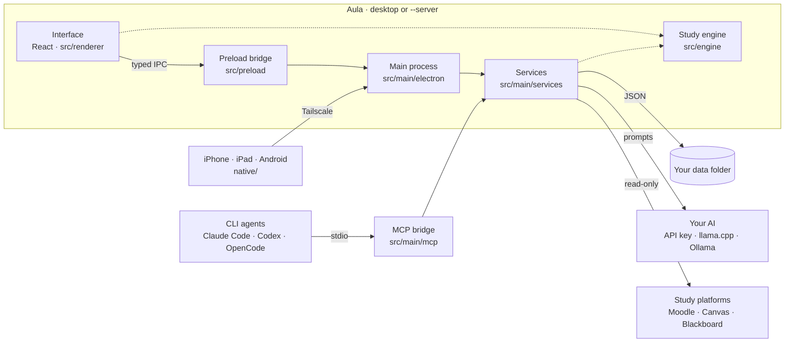

<!-- Keep in sync with README.es.md: same sections in the same order, same media (the -es stills). -->
<p align="right"><b>English</b> · <a href="README.es.md">Español</a></p>

<p align="center">
  
</p>

<h1 align="center">Aula</h1>

<h3 align="center">Turn your class notes into a course, with an AI tutor that studies it with you.</h3>

<p align="center">
  A free, open-source desktop study app. Drop in your lecture notes, slides or past exams, bring them from Moodle or
  Canvas, or just name a topic, and get lessons, exercises checked as you answer, flashcards and mock exams. Works with
  the ChatGPT or Claude plan you already have, or a free local LLM that runs offline.
</p>

<p align="center">
  <a href="https://github.com/luumlabs/aula/releases/latest"></a>
  <a href="LICENSE.md"></a>
</p>

<p align="center">
  <a href="#see-it-in-90-seconds">
    <picture>
      <source media="(prefers-reduced-motion: reduce)" srcset="docs/media/landing/hero-still.jpg">
      
    </picture>
  </a>
  <br>
  <sub><a href="#see-it-in-90-seconds">Watch the 90-second demo</a> · the real app, sped up, with the simulated AI from its tests</sub>
</p>

<p align="center">
  <a href="https://github.com/luumlabs/aula/releases/latest"><b>Download for Windows, macOS or Linux</b></a>
  &nbsp;·&nbsp; free, no account, no tracking
</p>

## What you can do

### AI tutor

Ask about anything you're studying. Aula looks it up in your own notes, tells you the page and draws what it explains.
Next to every exercise, it gives you hints without giving the answer away.


<sub>This answer comes from the simulated AI that Aula's tests use, on the example course. Your AI writes its own.</sub>

### Courses

Short lessons that ask you to guess before they explain, with figures plotted from the real math, worked examples,
exercises checked as you answer and flashcards with spaced repetition.

<p>
  <picture>
    <source media="(prefers-reduced-motion: reduce)" srcset="docs/media/landing/lesson-still.jpg">
    
  </picture>
</p>

### Notes

Aula turns a course into notes you can print: a study guide, a summary or a cheat sheet with the formulas and the
mistakes to avoid, as PDF or Word. Your own PDFs open in a reader where you can highlight and ask about a page.


### Exams

A timed mock exam with the same sections, minutes and points as your real one. When you finish, you get a report by
topic and a button to practice what you missed. You can also print a practice exam.


## See it in 90 seconds

<!-- The video is the bare attachment URL on a line of its own: GitHub turns it into a player that also plays for
     visitors who aren't signed in. A <video src="…"> tag keeps the github.com URL, which they can't open. -->

https://github.com/user-attachments/assets/7becaa0b-db21-4d95-b9d6-fc581fab9b4d

<sub>A whole course, end to end: built from four files, then a lesson, an exercise that catches a common mistake, the
mistakes notebook, flashcards, a mock exam and the plan for today. No voice. Player not loading?
<a href="https://github.com/luumlabs/aula/raw/main/docs/media/demo/aula-demo-90s.mp4">Download the MP4 (9 MB)</a>.</sub>

## Why Aula

- **Any subject, your syllabus.** Calculus, organic chemistry, anatomy, a language, a driving test. With your class
  materials the course follows your syllabus. Without them, a line like *Statistics for psychology, final in May* is
  enough.
- **It reads what you already have.** PDFs, Word, PowerPoint, photos of the whiteboard, recordings of a class, links, or
  your school platform: Moodle, Canvas, Blackboard, Google Classroom, Brightspace and more. It only reads: it never
  submits anything for you.
- **Your AI, or a free one that runs offline.** The Claude or ChatGPT subscription you already pay for, an API key, or a
  local LLM (llama.cpp, Ollama, LM Studio) on your own computer.
- **It remembers for you.** Flashcards with spaced repetition (FSRS), a notebook that brings your mistakes back after 1,
  3, 7, 16 and 35 days, and a plan for today that starts with what will raise your grade the most.
- **Wherever you study.** Windows, macOS and Linux. With Aula on a Mac or on a [server at home](docs/SERVER.md), you
  can open it from your [iPhone, iPad or Android](docs/DEVICES.md) too.

Every screen, tool and shortcut: [docs/FEATURES.md](docs/FEATURES.md).

<sub>Aula is young and built in the open. If it looks useful, starring the repo (the Star button at the top of this
page) helps other students find it.</sub>

## Quick start

**Use it.** Get the installer for your system from the
[latest release](https://github.com/luumlabs/aula/releases/latest). It's free and needs no account.

- **Windows** 10 and 11 (x64 and ARM): `Aula-Setup-<version>.exe`. If SmartScreen shows up, click *More info → Run
  anyway* (Aula isn't code-signed for Windows yet).
- **macOS** 13 or later (Apple Silicon and Intel): `Aula-<version>-mac.dmg`. Drag Aula to *Applications* and open
  it: it's signed with an Apple Developer ID and notarized.
- **Linux** x64 and ARM64: the `.AppImage` (`chmod +x` it, then open it) or, on x64, the `.deb`
  (`sudo apt install ./Aula-<version>-linux-amd64.deb`).
- **Android** 8 or later: `Aula-<version>-android.apk`, a window to Aula running on your Mac or on
  [your own server](docs/SERVER.md) (see [Devices](docs/DEVICES.md)).

The first time, Aula asks your name, helps you [pick an AI](#pick-an-ai) and gives you example courses to try. It
updates itself (with the `.deb`, it tells you when a new version is out). Step by step, updating from 0.1.x, Linux notes
and troubleshooting: [docs/INSTALL.md](docs/INSTALL.md).

> [!NOTE]
> Aula is in early access. It works, but you'll find bugs and rough edges, and things change between versions. Please
> don't make it the only way you prepare for an important exam yet, and [tell me](#how-to-help) when something breaks.

**Run it from source** (Node.js 22.12 or later, and Git):

```bash
git clone https://github.com/luumlabs/aula.git && cd aula
npm install
npm run dev
```

The first `npm run dev` downloads Electron and then opens the app with hot reload. No AI key? Run
`AULA_FAKE_AI=1 npm run dev` (in PowerShell, `$env:AULA_FAKE_AI=1; npm run dev`) for a simulated one. If you also use
Aula day to day, set `AULA_HOME` to an empty folder as well, so the dev build keeps its own data.

## Pick an AI

Already pay for ChatGPT or Claude? Aula uses that plan. If not, it can set up a free AI on your computer that works
offline. It picks the best option it finds, and you can change it any time in *Settings → Your AI*. Without any AI, you
can still study the example courses and any course you already have.

- **Claude subscription** (Pro or Max): the official `claude` CLI, signed in. Included in your plan.
- **ChatGPT subscription** (Plus or Pro): *Connect with ChatGPT* in Aula (it uses the official Codex CLI). Included in
  your plan.
- **A model on your computer**: nothing to set up. Aula suggests one that fits your RAM and downloads `llama.cpp` and a
  verified model. Ollama and LM Studio are detected too. Free, and it works offline.
- **An API key** from Anthropic, OpenAI, Google Gemini, OpenRouter, DeepSeek and more, or from any OpenAI-compatible
  service. You pay the provider, with an optional daily limit.

OpenCode works too, if it's installed and signed in. More detail: [docs/FEATURES.md](docs/FEATURES.md#your-ai-in-detail).

<p align="center">
  <picture>
    <source media="(prefers-color-scheme: dark)" srcset="docs/media/screenshots/providers-dark-en.svg">
    
  </picture>
  <br>
  <sub>Logos are trademarks of their owners and only identify each service (sources in <a href="THIRD_PARTY_NOTICES.md#ai-provider-logos">THIRD_PARTY_NOTICES.md</a>).</sub>
</p>

## Privacy

- Your courses, progress, calendar, chats, documents, notes and memory are files on your computer. No account, no ads,
  no analytics.
- Only what each task needs goes to the AI you picked, and nothing does with a local model. Keys are encrypted with your
  system's keychain.
- The full policy: [docs/PRIVACY.md](docs/PRIVACY.md).

<details>
<summary><b>Everything that can leave your computer, and when</b></summary>

- Your courses, progress, calendar, chats, documents, notes and memory are stored on your computer, in
  `~/Library/Application Support/Aula` (macOS), `%APPDATA%\Aula` (Windows) or `~/.config/Aula` (Linux). You can study
  offline.
- No account, no ads, no analytics. Aula doesn't collect usage data.
- What does leave your computer, and only when it's needed:
  - what the AI needs for each task goes to the AI provider you picked (nothing does if you use a local model);
  - web searches go to DuckDuckGo, and pages the AI reads are fetched from their sites, but only while web search is on
    (*Settings → Privacy and data → Web search*, and *Search the web if something's missing* when you create a course).
    Claude Code, Codex and OpenCode use Aula's web tools for this, never their own;
  - images come from Wikimedia Commons, and the pages you open on your study platform come from that platform;
  - calendar links you subscribe to, and links you add as course materials, are fetched from those sites;
  - the OCR language data, from the jsDelivr CDN, the first time Aula reads a photo, and on Linux the spell-check
    dictionary for your language, once, from Google's servers;
  - downloads you ask for: the local AI engine and models from GitHub and Hugging Face, and Codex from GitHub;
  - the update check, which asks GitHub for the latest version without sending any identifier (GitHub still sees your
    IP address, as with any download).
- API keys, platform sessions and private calendar links are encrypted with your system's keychain (Keychain on macOS,
  DPAPI on Windows, GNOME Keyring or KWallet on Linux). Aula's browser has its own profile and never touches yours. The
  app doesn't ship with any keys inside.
- An exported course (`.aulapack`) never includes your keys, and you decide whether it includes your progress.
- *Settings → Privacy and data* opens your data folder, exports everything as a `.zip` (without keys or platform
  sessions) or deletes all your data.

</details>

## How to help

<a href="https://github.com/luumlabs/aula/issues?q=is%3Aissue+is%3Aopen+label%3A%22good+first+issue%22"></a>

Aula is made in the open, and you don't need to be an expert to help.

- **Pick a [good first issue](https://github.com/luumlabs/aula/issues?q=is%3Aissue+is%3Aopen+label%3A%22good+first+issue%22).**
  Each one is small, names the files to touch and says how to check it: a unit converter fix, new formulas, tests, a
  translation. Comment on it so nobody else starts the same one.
- **Report what breaks.** [Open a bug report](https://github.com/luumlabs/aula/issues/new?template=bug_report.yml) with
  what you did, what happened, your system, Aula's version (*Settings → About*) and your AI. Issues are public, so never
  paste keys, passwords, private calendar links or anything personal.
- **Suggest an idea** [here](https://github.com/luumlabs/aula/issues/new?template=idea.yml).
- **Translate.** The interface is in English and Spanish. Issues labelled
  [translation](https://github.com/luumlabs/aula/labels/translation) are a good way in.
- **Tell someone who's studying**, or share Aula in your class group. It helps more than you'd think.
- **Sponsor it** through [GitHub Sponsors](https://github.com/sponsors/luumlabs), monthly or once. Aula is free and will
  stay free.

To work on the code, [run it from source](#quick-start): it takes three commands, and `AULA_FAKE_AI=1` gives you a
simulated AI, so you don't need a key. Then start with [CONTRIBUTING.md](CONTRIBUTING.md) and
[How it's built](#how-its-built). Security problems go privately: see [SECURITY.md](SECURITY.md).

## Community

Aula grows in public. To follow along, see how it's going or ask something that isn't a bug, I'm on Reddit as
[u/astrolafi](https://www.reddit.com/user/astrolafi).

## How it's built

Aula is an Electron app written in TypeScript and React. The same app runs without a window as a server
([`--server` or the Docker image](docs/SERVER.md)), and the phone and tablet apps are windows to it.



<details>
<summary><b>Where things live, commands and environment variables</b></summary>

| Folder | What's there |
| --- | --- |
| `src/renderer` | The React interface. Every text goes through i18n (`i18n/locales/{en,es}`) |
| `src/preload` | The only bridge between the interface and the main process (`window.aula`), with `contextIsolation` and a sandbox |
| `src/main/electron` | The only code that imports Electron: windows, the typed IPC, the keychain, updates, the device server |
| `src/main/services` | Plain Node: courses, AI providers, the agents that build courses, the tutor, file import, study platforms |
| `src/engine` | Pure TypeScript shared by both sides: grading, exact math, FSRS, chemistry, the course validator |
| `src/main/mcp` | The MCP bridge that lets Claude Code, Codex and OpenCode use Aula's tools |
| `native/` · `server/` | The iPhone/iPad and Android apps, the Tailscale sidecar, and Aula as a headless server (`--server`, Docker) |

| Command | What it does |
| --- | --- |
| `npm run typecheck` | TypeScript for the main process and the interface |
| `npm test` | Unit tests (vitest) |
| `npm run build` | Builds into `out/` |
| `npm run e2e` | Builds and runs the end-to-end tests on the real Electron app with a simulated AI (on Linux, prefix it with `xvfb-run -a`) |
| `npm run dist:mac` · `dist:win` · `dist:linux` | Installers into `release/` |

Handy environment variables: `AULA_HOME` (use another data folder), `AULA_FAKE_AI=1` (a simulated AI) and
`AULA_NO_UPDATES=1`.

The app is built with Electron 44, React 19, TypeScript and Tailwind CSS 4. The study engine in `src/engine` (grading,
exact math, FSRS, chemistry, the course validator) is plain TypeScript shared by the main process and the interface.
The Node services in `src/main/services` handle courses, AI providers, the agents, the assistant, automations, file
import and study platforms, and only `src/main/electron` talks to Electron. The interface and the main process talk
over one typed IPC channel, with `contextIsolation`, a sandbox and a strict CSP. There are more notes for developers in
[`CLAUDE.md`](CLAUDE.md).

</details>

Before a pull request, read [CONTRIBUTING.md](CONTRIBUTING.md). The code rules, IPC contracts and data formats are in
[CLAUDE.md](CLAUDE.md), and releases in [docs/PUBLISHING.md](docs/PUBLISHING.md).

## Thanks

Aula is built on a lot of open source work, mainly [Electron](https://www.electronjs.org),
[React](https://react.dev), [Vite](https://vite.dev), [Tailwind CSS](https://tailwindcss.com),
[three.js](https://threejs.org), [KaTeX](https://katex.org), [PDF.js](https://mozilla.github.io/pdf.js/) and
[Tesseract.js](https://tesseract.projectnaptha.com). When you ask for it, Aula also downloads
[llama.cpp](https://github.com/ggml-org/llama.cpp), the open models you choose and the
[Codex CLI](https://github.com/openai/codex). The full list of components and their licenses is in
[`THIRD_PARTY_NOTICES.md`](THIRD_PARTY_NOTICES.md), and every installed copy carries the license text of each package
inside it (`THIRD_PARTY_LICENSES.txt`, next to the app's resources).

Many of Aula's figures (diagram shapes such as pyramids, Venn diagrams and mind maps, molecules drawn from SMILES,
drawings that move, «mark and ask the tutor», countries on maps) are adapted from
[Sketchy](https://github.com/ddkbs/sketchy) by ddkbs, under the MIT license. Thank you!

## License

Aula is free and open source under the [GNU Affero General Public License v3.0 only](LICENSE.md) (AGPL-3.0-only).
Copyright © 2026 Luum Labs. It comes with no warranty. In short:

- You can use it for anything, study how it works, change it and share it.
- If you share a modified version, or let people use it over a network, you must offer them
  its complete source code under this same license.
- A modified version needs its own name and icon. You can copy and change the code and the artwork, but a modified
  version can't be called "Aula" or use Aula's icon. Unmodified copies can keep both. The exact terms (section 7) are
  in [`NOTICE.md`](NOTICE.md).
- Third-party components keep their own licenses: see [`THIRD_PARTY_NOTICES.md`](THIRD_PARTY_NOTICES.md).
- To take part in the project, see [`CONTRIBUTING.md`](CONTRIBUTING.md) and the [Code of Conduct](CODE_OF_CONDUCT.md).
